<div align="center">

# 🔑 ZeroAuth

**Motore di Autenticazione Self-Hosted e Decentralizzato con Passkeys & WebAuthn.**  
*Zero Costi Email. Zero Password Trapelate. Zero Vendor Lock-in.*

[](README.md)
[](#)
[](LICENSE)
[](https://github.com/MRJonam91/ZeroAuth/releases/tag/v0.3.0-beta)
[](https://github.com/sponsors/MRJonam91)
[](https://ko-fi.com/mrjonam)
[](https://buymeacoffee.com/mrjonam)
[](https://paypal.me/manorollo)

<br/>

<p align="center">
  
</p>

</div>

---

## ⚡ Il Problema: Perché gli Indie Hacker Cercano un'Alternativa

I provider di autenticazione cloud (Auth0, Clerk, Supabase Auth, Firebase) rappresentano un ostacolo critico per sviluppatori indipendenti e startup:

| Aspetto | Cloud SaaS Auth (Auth0 / Clerk) | ZeroAuth Self-Hosted |
| :--- | :--- | :--- |
| **Costi su Scala** | Più di 350$/mese superati i 10k MAU | **0.00$ per Sempre** |
| **Spese E-mail/SMS** | Costi continui con Resend/SendGrid/Twilio | **0.00$ (Nessuna email necessaria)** |
| **Rischio Sicurezza** | Phishing, credential stuffing, violazioni DB | **Zero Trust (Enclave Hardware)** |
| **Vendor Lock-in** | Credenziali ed utenti su cloud proprietari | **100% Tuoi su SQLite / PostgreSQL** |
| **Complessità Codice**| SDK pesanti con decine di dipendenze | **Ultra-leggero (Core < 1.500 LOC)** |

---

## 🌟 Funzionalità Principali (Beta v0.3.0)

- 👆 **Biometria in 1-Tap**: Touch ID, Face ID, Windows Hello, Android Biometrics e chiavi fisiche YubiKey.
- ⚡ **Zero Password, Zero Email**: L'identità è vincolata a coppie di chiavi asimmetriche generate nella Secure Enclave del dispositivo.
- 🔑 **Supporto Multi-Passkey**: Registra più chiavi hardware di backup per lo stesso utente (es. Mac + iPhone + YubiKey), con rinomina ed eliminazione.
- 🏷️ **Riconoscimento Hardware AAGUID**: Identifica automaticamente il modello di autenticatore (Apple iCloud Keychain, Windows Hello, YubiKey 5, Google).
- 🛡️ **Protezione Anti-Abuso (Rate Limiter)**: Throttling a finestra scorrevole integrato per proteggere le challenge da flood e DoS.
- 🌐 **Universal Web Standard Handler**: Pronto all'uso per Next.js App Router, Hono, SvelteKit, Astro, Bun, Express e Fastify in 1 sola riga.
- ⚛️ **Componenti UI React Pronti**: `<PasskeyButton>` e `<PasskeyList>` con gestione stato globale tramite `<ZeroAuthProvider>`.
- 🧩 **Adattatori PostgreSQL & SQLite**: Driver di produzione `PostgresStorageAdapter` e driver leggero zero-dependency `SqliteStorageAdapter`.
- 🪶 **Core < 1.500 LOC (833 LOC)**: Architettura modulare progettata per essere auditabile e manutenibile in meno di 1 ora.

---

## 🏗️ Architettura del Monorepo

```
packages/
├── core/       # Primitive crittografiche WebCrypto pure (< 1.500 LOC, zero dipendenze pesanti)
├── server/     # Relying Party server handler, gestione sessioni e storage adapters
├── client/     # SDK per browser con Conditional UI (Autofill) e controlli hardware
└── react/      # Hook reattivi (usePasskey) per integrazione immediata in React/Next.js
```

---

## 💖 Supporto & Donazioni

ZeroAuth è sviluppato e mantenuto come progetto open source indipendente. Se ZeroAuth ti fa risparmiare centinaia di dollari di abbonamenti ad Auth0 o Clerk, supporta il lavoro:

- 🌟 **Lascia una stella (Star)** alla repository
- 💖 **[Sponsorizza su GitHub](https://github.com/sponsors/MRJonam91)**
- ☕ **[Offri un caffè su Ko-fi](https://ko-fi.com/mrjonam)**
- 🍕 **[Supporta su Buy Me a Coffee](https://buymeacoffee.com/mrjonam)**
- 💳 **[Donazione diretta via PayPal](https://paypal.me/manorollo)**

---

## 💼 Licenze Commerciali & Vendita del Progetto

ZeroAuth adotta un modello di **Dual-Licensing (Doppia Licenza)**:

1. **Open Source (AGPLv3)**: Gratuito per progetti che rispettano la licenza copyleft AGPLv3.
2. **Licenza Commerciale Proprietaria**: Obbligatoria per applicazioni commerciali closed-source, SaaS proprietari o accordi white-label.
3. **Cessione / Vendita Progetto (IP Buyout)**: L'autore (**MRJonam91**) è disponibile a valutare offerte di acquisizione completa del progetto e della relativa proprietà intellettuale.

Consulta i documenti dedicati:
- Italiano: [`docs/it/LICENZA_COMMERCIALE.md`](docs/it/LICENZA_COMMERCIALE.md)
- Inglese: [`docs/COMMERCIAL_LICENSE.md`](docs/COMMERCIAL_LICENSE.md)

---

## 📄 Licenza

Distribuito sotto licenza **GNU Affero General Public License v3 (AGPLv3)** con opzioni di licenza commerciale. Consulta il file [LICENSE](LICENSE).
