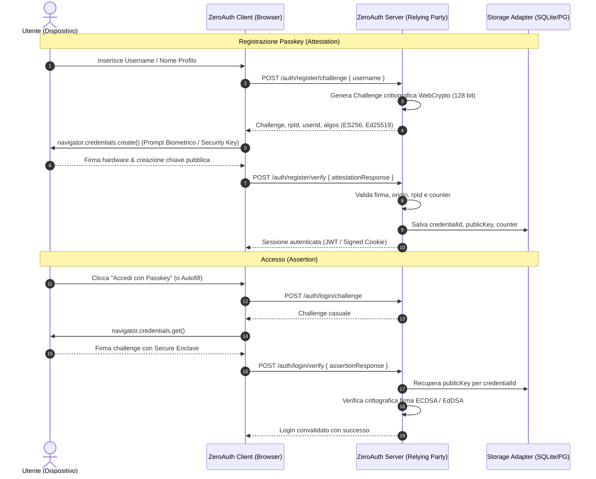

<div align="center">

# 🔑 ZeroAuth

**Self-Hosted, Decentralized Passkeys & WebAuthn Authentication Engine.**  
*Zero Email Fees. Zero Password Leaks. Zero Vendor Lock-in.*

[](https://opensource.org/licenses/MIT)
[](https://nodejs.org/)
[](https://www.w3.org/TR/webauthn-3/)
[](https://github.com/MRJonam91/ZeroAuth/pulls)

</div>

---

## 💡 Il Problema

I fornitori di autenticazione in cloud (Auth0, Clerk, Supabase Auth, Firebase) presentano ostacoli critici per indie hacker, sviluppatori e progetti bootstrapped:

1. **Costi Esponenziali & Surprise Bills**: Piani gratuiti con limiti stringenti di Monthly Active Users (MAU). Oltrepassata la soglia, i costi esplodono a centinaia di dollari al mese.
2. **Costi Invisibili su Canali Terzi**: Invio di e-mail transazionali (SendGrid, Postmark, Resend) o SMS (Twilio) per Magic Links e codici OTP di verifica.
3. **Vendor Lock-in & Privacy**: I dati degli utenti e le sessioni risiedono su infrastrutture proprietarie esterne.
4. **Debito di Sicurezza delle Password**: Hashing (bcrypt/argon2), requisiti di complessità, attacchi di brute-force, credential stuffing e procedure di reset password continuano a causare vulnerabilità.

---

## 🚀 La Soluzione: ZeroAuth

**ZeroAuth** trasforma il paradigma dell'autenticazione sfruttando le specifiche standard **W3C WebAuthn** e **FIDO2**:

- 🛡️ **Passkeys Hardware & Biometriche**: Touch ID, Face ID, Windows Hello, YubiKey o Secure Enclave dello smartphone.
- ⚡ **Zero Passwords, Zero E-mail, Zero OTP**: L'identità è legata a una coppia di chiavi asimmetriche hardware (privata sul client, pubblica sul server). Nessuna password da memorizzare, nessuna mail da attendere.
- 💰 **100% Self-Hosted & Costo Zero**: Esegui il Relying Party direttamente nel tuo backend (Node.js, Express, Fastify, Hono, Next.js).
- 🧩 **Storage Agnostico**: Supporta SQLite/LibSQL (Turso/local), PostgreSQL, MySQL, Redis o qualsiasi memoria documentale tramite una singola interfaccia adapter.
- 📱 **Conditional UI (Passkey Autofill)**: Supporto nativo per il completamento automatico delle credenziali nel browser, garantendo un'esperienza di login in 1 click senza attrito.
- 🔒 **Phishing-Resistant**: Le chiavi crittografiche sono vincolate all'origine del dominio (`rpId`). Nessun hacker può simulare il login su un dominio fake.

---

## 🏗️ Architettura del Monorepo

ZeroAuth è organizzato come monorepo modulare, consentendo di importare solo i componenti necessari:

```
packages/
├── core/       # Primitives WebAuthn/FIDO2 standard (zero dipendenze pesanti, puro WebCrypto)
├── server/     # Relying party server handler, gestione sessioni e storage adapters
├── client/     # Browser SDK: navigator.credentials wrappers, autofill e fallbacks
└── react/      # Hooks (useZeroAuth, usePasskey) e componenti headless per React / Next.js
```

### Flusso Operativo WebAuthn



---

## 📂 Documentazione e Specifiche

Per consultare l'analisi dettagliata, il threat model e i diagrammi architetturali:

- [Panoramica Architettura](docs/architecture/01-overview.md)
- [Specifiche WebAuthn & Flussi](docs/architecture/02-webauthn-spec.md)
- [Threat Model & Sicurezza](docs/architecture/03-threat-model.md)
- [Storage Adapters Guide](docs/architecture/04-storage-adapters.md)
- [Roadmap di Sviluppo](docs/roadmap.md)

---

## 🛣️ Roadmap Sintetica

- [x] **Milestone 1**: Analisi requisiti, specifiche di sicurezza, threat model e architettura monorepo.
- [ ] **Milestone 2**: `@zeroauth/core` - Generazione challenge, parsing CBOR/COSE, verifica firme crittografiche WebCrypto.
- [ ] **Milestone 3**: `@zeroauth/server` - Adapters HTTP (Node, Hono, Next.js) e Storage (Memory, SQLite, PostgreSQL).
- [ ] **Milestone 4**: `@zeroauth/client` - SDK browser con Conditional UI e supporto cross-device.
- [ ] **Milestone 5**: `@zeroauth/react` - Headless hooks e componenti drop-in.
- [ ] **Milestone 6**: Esempi pratici, documentazione interattiva e programma per sostenitori / donazioni.

---

## 🤝 Contribuire & Sostenere

ZeroAuth è un progetto Open Source pensato per la comunità indie. Se questo progetto ti fa risparmiare tempo e costi di abbonamento ad Auth0 o Clerk, considera di supportare lo sviluppo futuro:

- Lascia una ⭐️ sulla repository
- Segnala idee e miglioramenti nelle [Issue](https://github.com/MRJonam91/ZeroAuth/issues)
- Invia una [Pull Request](https://github.com/MRJonam91/ZeroAuth/pulls)

---

## 📄 Licenza

Distribuito sotto licenza **MIT**. Consulta il file [LICENSE](LICENSE) per ulteriori informazioni.
