<div align="center">

# 🔑 ZeroAuth

**Self-Hosted, Decentralized Passkeys & WebAuthn Authentication Engine.**  
*Zero Email Fees. Zero Password Leaks. Zero Vendor Lock-in.*

[](#)
[](README.it.md)
[](LICENSE)
[](https://github.com/MRJonam91/ZeroAuth/releases/tag/v0.2.0-alpha)
[](https://github.com/sponsors/MRJonam91)
[](https://ko-fi.com/mrjonam)
[](https://buymeacoffee.com/mrjonam)
[](https://paypal.me/manorollo)

<br/>

<p align="center">
  
</p>

</div>

---

## ⚡ The Problem: Why Indie Hackers Need an Alternative

Traditional cloud auth providers (Auth0, Clerk, Supabase Auth, Firebase) create major blockers for indie hackers, solopreneurs, and bootstrapped startups:

| Issue | Cloud SaaS Auth (Auth0 / Clerk) | ZeroAuth Self-Hosted |
| :--- | :--- | :--- |
| **Pricing at Scale** | $350+/mo once you exceed 10k MAU | **$0.00 Forever** |
| **Email/SMS Costs** | High SendGrid/Resend/Twilio monthly bills | **$0.00 (No emails needed)** |
| **Security Risk** | Phishing, credential stuffing, password leaks | **Zero Trust (Hardware Enclaves)** |
| **Vendor Lock-in** | Your users and credentials live in their cloud | **100% Owned on your SQLite / PG** |
| **Code Weight** | Heavy blackbox SDKs with dozens of dependencies | **Ultra-lightweight (Core < 1,500 LOC)** |

---

## 🌟 Key Features

- 👆 **1-Tap Biometrics**: Touch ID, Face ID, Windows Hello, Android Biometrics, YubiKey hardware keys.
- ⚡ **Zero Passwords, Zero Emails**: Identity is bound to asymmetric cryptographic keypairs generated inside hardware Secure Enclaves.
- 🛡️ **Phishing-Proof by Design**: Bound directly to your domain origin via the W3C WebAuthn Level 3 protocol.
- 🧩 **Pluggable Persistence**: Agnostic `ZeroAuthStorageAdapter` interface supporting SQLite/LibSQL (Turso/local file) and PostgreSQL.
- 📱 **Conditional UI (Passkey Autofill)**: Native 1-click credential suggestions directly in browser input forms.
- 🪶 **Core < 1,500 LOC**: Clean, zero-bloat architecture designed so any developer can audit and extend it in under an hour.

---

## 🏗️ Monorepo Architecture

```
packages/
├── core/       # Pure WebCrypto FIDO2 primitives (< 1,500 LOC, zero heavy dependencies)
├── server/     # Relying Party server handlers, session manager & storage adapters
├── client/     # Browser SDK with Conditional UI (Autofill) & device checks
└── react/      # Headless hooks (usePasskey) for instant React/Next.js integration
```

---

## 💖 Support & Sponsorship

ZeroAuth is built and maintained as an independent open-source initiative. If ZeroAuth saves you hundreds of dollars in monthly Auth0 or Clerk bills, please support development:

- 🌟 **Star this repository** to boost visibility
- 💖 **[Sponsor on GitHub](https://github.com/sponsors/MRJonam91)**
- ☕ **[Support on Ko-fi](https://ko-fi.com/mrjonam)**
- 🍕 **[Buy Me a Coffee](https://buymeacoffee.com/mrjonam)**
- 💳 **[Direct Donation via PayPal](https://paypal.me/manorollo)**

---

## 💼 Commercial Licensing & Project Acquisition

ZeroAuth operates under a **Dual-Licensing Model**:

1. **Open-Source (AGPLv3)**: Free for open-source projects complying with AGPLv3 copyleft terms.
2. **Commercial License**: Required for proprietary, closed-source SaaS applications, enterprise systems, white-labeling, or avoiding AGPLv3 copyleft.
3. **Full Project Acquisition**: The author (**MRJonam91**) is open to discussing full IP buyouts and project acquisition by interested companies.

See [`docs/COMMERCIAL_LICENSE.md`](docs/COMMERCIAL_LICENSE.md) or [`docs/it/LICENZA_COMMERCIALE.md`](docs/it/LICENZA_COMMERCIALE.md) for full details.

---

## 📄 License

Distributed under the **GNU Affero General Public License v3 (AGPLv3)** with Commercial Licensing options. See [LICENSE](LICENSE) for details.
