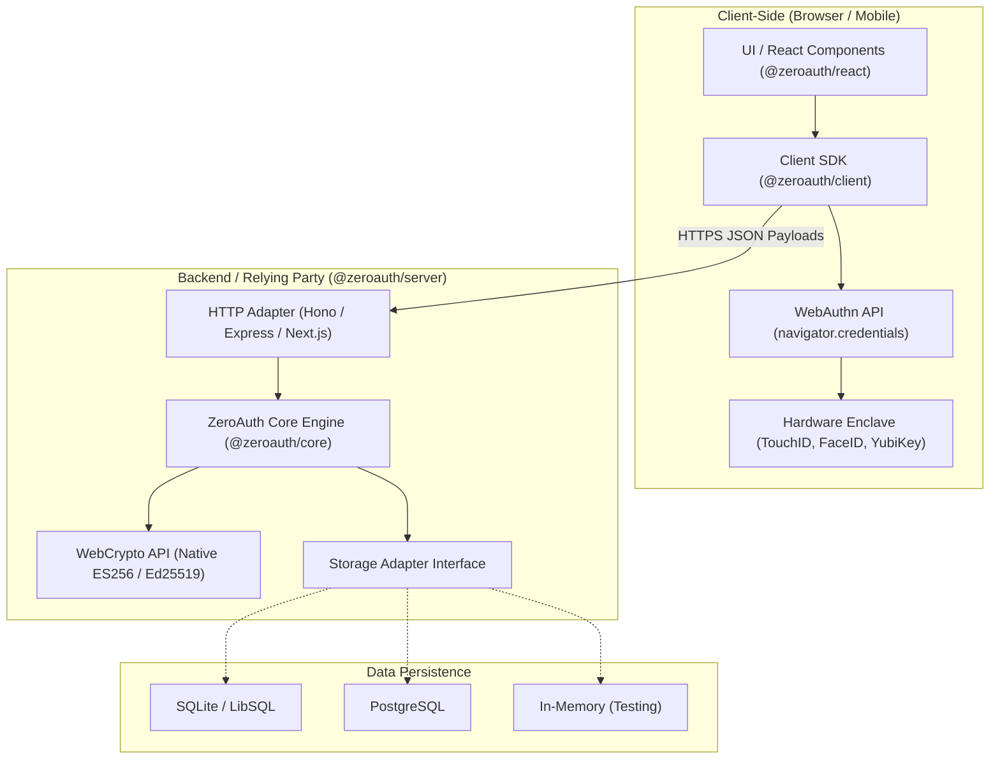

# 01. Architettura & Visione di ZeroAuth

## Visione del Progetto

Nel panorama dello sviluppo web moderno, l'autenticazione è diventata un centro di costo e di complessità ingiustificato. I servizi SaaS (Auth0, Okta, Clerk, Stytch) impongono modelli tariffari basati sui Monthly Active Users (MAU), trasformando il successo di un progetto indie o di una startup in una bolletta insostenibile. Inoltre, l'utilizzo di Magic Links comporta spese vive per servizi di mailing transazionale (SendGrid, Postmark, Resend) e problemi continui di deliverability/spam.

**ZeroAuth** nasce con una tesi fondamentale:  
> **L'hardware moderno (telefoni, laptop, token fisici) possiede già tutta l'infrastruttura di sicurezza necessaria per autenticare un utente senza intermediari a pagamento.**

Attraverso gli standard aperti **W3C WebAuthn** e **FIDO2**, è possibile scambiare chiavi crittografiche asimmetriche direttamente tra il browser dell'utente e il server dell'applicazione.

---

## Principi Guida

1. **Zero External Dependencies / Self-Hosted First**:  
   Nessuna chiamata verso server esterni durante il flusso di login. Tutto il Relying Party (RP) viene eseguito nell'infrastruttura dello sviluppatore.

2. **Zero Cost Infrastructure**:  
   Nessuna dipendenza da provider SMS o provider e-mail per il login ordinario. Zero costi di licenza MAU.

3. **Privacy & Decentralizzazione dei Dati**:  
   Nessun dato o identificativo dell'utente viene inviato a terze parti per profilazione o analisi. I dati rimangono nel database del proprietario.

4. **Modularità & Zero Bloat**:  
   Architettura stratificata a pacchetti separati:
   - Chi desidera solo le primitive crittografiche usa `@zeroauth/core`.
   - Chi necessita di un backend pronto per Hono/Express/Next.js usa `@zeroauth/server`.
   - Chi sviluppa client SPA o web app usa `@zeroauth/client` o `@zeroauth/react`.

5. **Storage Agnostico**:  
   Separazione netta tra logica di business e persistenza dei dati. Un'interfaccia semplice consente di collegare SQLite locale per un side-project da 0$ su VPS economica, o PostgreSQL per carichi enterprise.

---

## Diagramma dei Componenti

